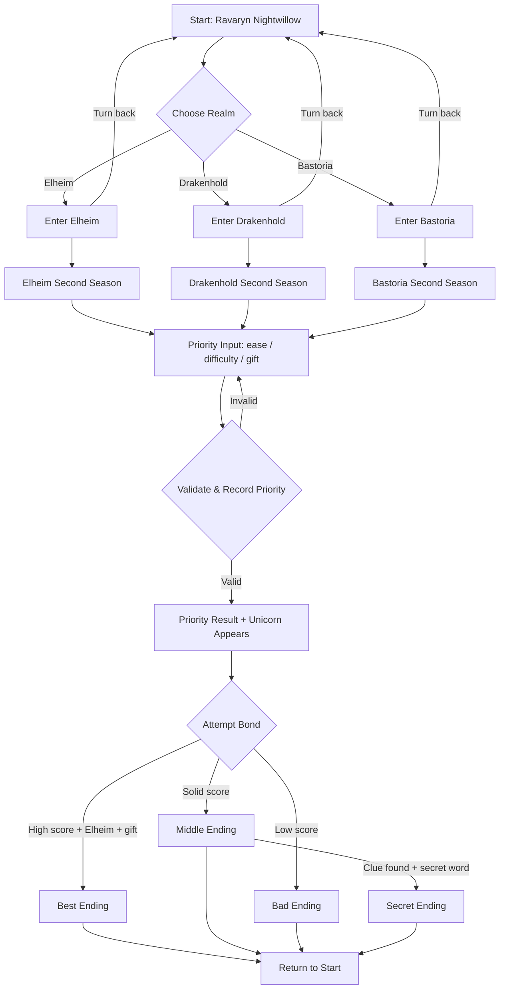

# Web115_Final_Project

# The Unicorn Bond: Ravaryn's Quest

Interactive browser-based adventure story. Solo final project.

## Team Members and Roles

- **Robyn Farley** — Sole developer and author. Responsible for story design, flowchart, HTML structure, CSS styling, all JavaScript logic (classes, state management, event listeners, validation, endings), image assets, and documentation.

## Application Overview

You play as Ravaryn Nightwillow, warrior-princess of the Silverleaf elves. The Shadowblight is consuming her homeland. Only a spirit-bond with a unicorn can restore balance.

**Gameplay**
- Choose one of three hunting realms at the start:
  - **Elheim** (Elderwood Veil) — highest difficulty, rarest unicorns, strongest gifts
  - **Drakenhold** (Ashen Peaks) — medium difficulty, more unicorns, solid gifts
  - **Bastoria** (Verdant Shores) — easiest, most unicorns, moderate gifts
- Each realm has an initial exploration and a “second season” of deeper challenges.
- At the second season you must declare your priority by typing one word: `ease`, `difficulty`, or `gift`. Input is validated with a regular expression.
- Your choices raise a Bond Progress score and Affinity. Inventory and a journey log update dynamically.
- Progress is saved automatically with `localStorage` (JSON) and a cookie remembers the last realm.
- Keyboard shortcuts: 1 / 2 / 3 for choices, Enter to submit text, S to force-save.
- Hover the image for a short tooltip.

**Endings**
- **Best** — Strongest magical unicorn (highest Spell Knowledge, Ingenuity, Stamina, Potential) and complete bond. Triggered by Elheim + gift priority + high bond score.
- **Middle** — Gifted unicorn and completed bond. Most successful paths land here.
- **Bad** — No unicorn found or bond refused. Low bond score or hesitant choices.
- **Secret** — After a successful bond, speaking the ancient word “alicorn” or “nightwillow” (discovered via lore fragment) levels the gifts further.

**Navigation**
Three main buttons drive choices. Text input appears only when needed. Inventory and log accumulate with `createElement` / `appendChild`. Image changes with a dedicated function. All major actions are wrapped in try-catch where appropriate.

## Story Flowchart

(13+ distinct nodes including all major branches and endings.)

## How to Run

1. Clone or download this repository.
2. Open `index.html` in any modern browser (or serve the folder with a local server).
3. All images are in the `images/` folder. JavaScript is external (`script.js`). CSS is external (`styles.css`).

## Features Implemented (Assignment Checklist)

- HTML: title, three paragraphs with ids, buttons with ids, image with id
- CSS: image sizing, button and text styling, responsive layout
- JS: element references, multiple functions, conditionals, loops (inventory/log), dynamic DOM creation, 3 classes (Player, Unicorn, Realm), JSON save/load, try-catch, cookies, extensive event listeners (click, keydown, mouseover/mouseout), text input + regex validation, setTimeout / setInterval, image hover tooltip, state flags, inventory via appendChild, score tracking

No external libraries required beyond the browser. All assets local.
